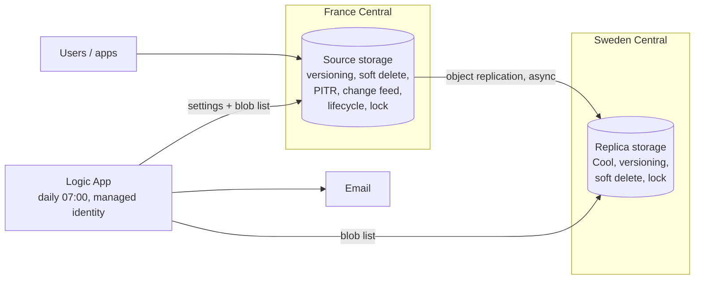

# Azure Automated Backup System

A backup setup on Azure Blob Storage that protects documents from accidental overwrites and deletes, keeps a copy in a second region, and emails me every morning to say whether it's still working. It's one of five Azure projects I'm building for my portfolio after passing AZ-104.

The client is made up: Corrib Accounting, a 9-person accountancy firm in Galway with about 40 GB of client documents. Everything in this repo is real and runs in my own subscription.

## Why I built it

A backup nobody checks isn't a backup. The storage part of this project is fairly standard, so the part I cared about most was the daily health check, and proving the whole thing can be rebuilt from code rather than from memory and screenshots.

## The scenario

Their "backup" was a USB drive updated whenever someone remembered. Two things had gone wrong:

- An intern overwrote a finished tax return with an old draft, and nobody noticed for 3 days.
- A deleted folder took 6 hours of manual work to recover.

What they needed was protection with no human in the loop, and some evidence that it was working.

## What I built

| Layer | What I used |
|---|---|
| Source storage | StorageV2, LRS, Hot tier, France Central |
| Data protection | Blob versioning, soft delete (7 days, blobs and containers), point-in-time restore (6 days), change feed |
| Cost control | Lifecycle rule: previous versions move to Cool after 30 days and are deleted after 90 |
| Second region | Replica account in Sweden Central (LRS, Cool tier, versioning, soft delete) fed by object replication from the `client-docs` container |
| Accident protection | Delete locks on both accounts |
| Verification | Logic App (Consumption plan) with a system-assigned managed identity, running daily at 07:00 Dublin time |
| Security | Shared key access off, anonymous access off, TLS 1.2, Entra-only auth, least-privilege roles. Details in [docs/security-notes.md](docs/security-notes.md) |

The Logic App's identity has Reader on the source account and Storage Blob Data Reader on both. It can read settings and list blobs, and it can't write or delete anything.

## Architecture



Versioning and soft delete cover human error. Point-in-time restore is meant for bulk damage to a container. Object replication covers losing a region. The health check closes the loop.

## The daily health check

Every morning the Logic App:

1. Reads the source account's settings through the Azure management API and checks that versioning, blob soft delete and point-in-time restore are all on.
2. Lists the blobs in the source and replica `client-docs` containers and compares the counts.
3. Sends one of three emails:

| Email | When |
|---|---|
| ✅ Backup healthy | All four checks pass |
| ❌ BACKUP ALERT | A setting is off, or the blob counts differ |
| ⚠️ BACKUP CHECK DID NOT RUN | A check step failed or timed out, so I don't know the state |

The third one exists because of a mistake I made (see below).

## How I built it

I built it in the portal first, one phase at a time, saving the ARM templates and screenshots as I went. Then I rewrote it as Bicep and deployed it into a brand-new empty resource group to prove I could rebuild it from code. Two things aren't pure Bicep:

- **Object replication** is configured by a small PowerShell script (`infra/scripts/configure-replication.ps1`). The destination policy gets a service-generated ID that the source policy has to reuse, and Bicep couldn't deal with that in one deployment. The script is safe to rerun.
- **The Outlook connection** has to be authorized once in the portal after deployment. Bicep can create the connection but can't sign in to my account.

`infra/deploy.ps1` runs the whole thing: resource group, Bicep, then the replication script.

## What I tested

| What | Result | Evidence |
|---|---|---|
| Overwrite recovery | Previous version promoted back to current (not timed) | `screenshots/phase1-versions.png` |
| Deleting the storage account | Blocked by the lock | `screenshots/phase4-delete-blocked.png` |
| Replication | A new blob appeared in the replica within 47 seconds in one test on the rebuild | `screenshots/phase7b-replication-timing.png` |
| Health check, healthy path | Email with all checks true and matching counts | `screenshots/phase5c-test1-healthy.png` |
| Health check, alert path | Pointed the replica check at an empty prefix, got the alert with count 0 | `screenshots/phase5c-test2-alert.png` |
| Health check, "did not run" path | Pointed it at a container that doesn't exist, got the warning email | `screenshots/phase5c-test3-did-not-run.png` |
| Scheduled runs | The 07:00 trigger ran on its own from 17 to 23 Oct | `screenshots/phase6-scheduled-run.png` |
| Hardening | With shared key access off, replication and the health check still worked | `screenshots/phase6-post-hardening.png` |
| Rebuild from code | Empty resource group to a working stack in 103 seconds, plus the manual Outlook step | `screenshots/phase7d-deploy-output.png` |
| Rebuild vs. portal build | Compared 11 account and blob-service settings across both pairs, no differences | `screenshots/phase7d-drift-check.png` |

## Things that went wrong

- **A portal preset overrode my choice.** The "Backup and archive" preset set the replica to RA-GRS. I caught it on the review page and changed it to LRS. I read the review page properly after that.
- **Delete doesn't behave how I expected with versioning on.** There's no undelete button. The data stays as a previous version, and recovery means promoting that version.
- **A typo made the health check fail silently.** I changed a storage account name in one URL and got it wrong. The step failed with a 403, and because the failure came before the email step, no email was sent. Silence looked exactly like "everything's fine". That's why the "did not run" email exists, and why the checks sit inside a Logic App scope.
- **403 doesn't always mean permissions.** Azure returned Forbidden for a resource that didn't exist, so I now read the full error before touching roles.
- **Bicep and object replication don't mix well.** The destination policy is created under the name `default` but stored under a generated ID. ARM then tried to read `default` back and failed, even though the policy had been created. I confirmed that by listing the policies, then moved that one resource into an idempotent script.

## What I haven't done

- **I didn't time any recovery drills.** I proved recovery works for overwrites and deletes, but I haven't measured how long it takes, so I can't claim an RTO or RPO.
- **I haven't restore-tested point-in-time restore.** It's configured and the health check confirms it's on, but I never actually restored a container with it.
- **I haven't tested what happens to the replica when a blob is deleted on the source.** I don't know yet whether the delete is copied.
- **The replication timing is a single measurement.** It's an observation, not a guarantee.
- **There's no storage firewall.** A Consumption Logic App calls out from shared regional IPs, so an IP allow-list would be unreliable. I rely on Entra-only authentication and RBAC instead.
- **The delete lock stops accidents, not people with Owner.** Immutable storage on the replica would close that gap.
- **Email goes through my personal Outlook.com account**, not a managed identity.
- **Nothing alerts me if the Logic App itself stops running.**

## Cost

I didn't produce a formal estimate. What drives the bill is stored data, how many old versions pile up, replication traffic and Logic App runs. I kept it down with LRS in both regions, a Cool tier replica, a lifecycle rule that tiers and deletes old versions, and a Consumption plan Logic App that bills per run.

## Deploying

You need an Azure subscription, the Azure CLI with Bicep, and an Outlook.com account for the email connection.

```powershell
az login
az account set --subscription "<subscription id>"
powershell -NoProfile -ExecutionPolicy Bypass -File .\infra\deploy.ps1 -ResourceGroup rg-backup -AlertEmail you@example.com
```

Then authorize the Outlook connection once: portal, resource group, **outlook** API connection, **Edit API connection**, **Authorize**, **Save**.

The deploy doesn't grant anyone access to the data. To browse or upload blobs yourself, give your user Storage Blob Data Contributor on the source account.

To tear it down, remove the locks first, because they block deleting the resource group:

```powershell
az lock list -g rg-backup --query "[].id" -o tsv | ForEach-Object { az lock delete --ids $_ }
az group delete -n rg-backup --yes
```

## Repository layout

```
docs/          security notes, ARM templates exported from the portal build
infra/         Bicep (main.bicep, modules/), deploy.ps1, scripts/configure-replication.ps1
logicapp/      health check workflow definition
screenshots/   evidence for each phase
```

## What I'd do next

- A private endpoint, with the Logic App moved to the Standard plan so it can use the VNet
- Immutable storage on the replica
- An alert for when the health check stops running
- Timed recovery drills, including a point-in-time restore and a check of what a source-side delete does to the replica

## Author

Funso Aringbangba. Azure Administrator Associate (AZ-104).